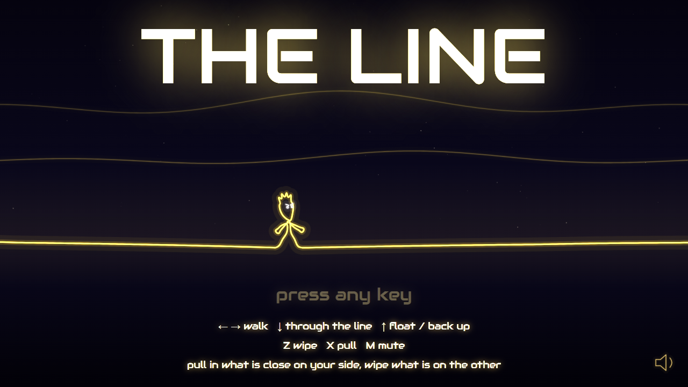
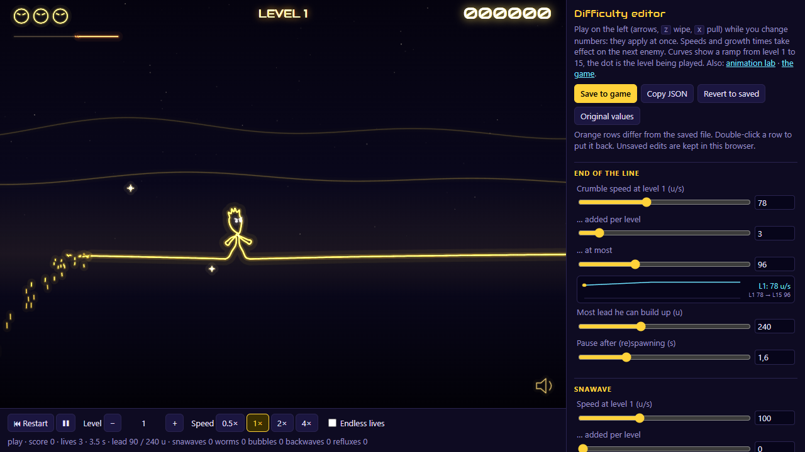
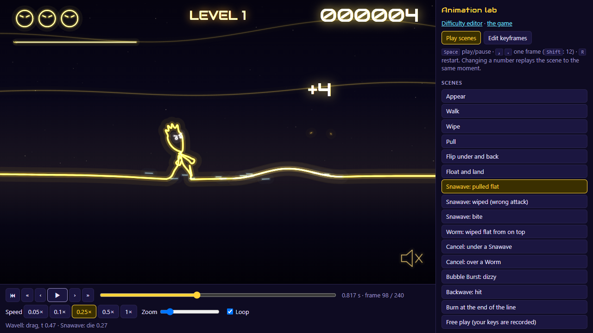
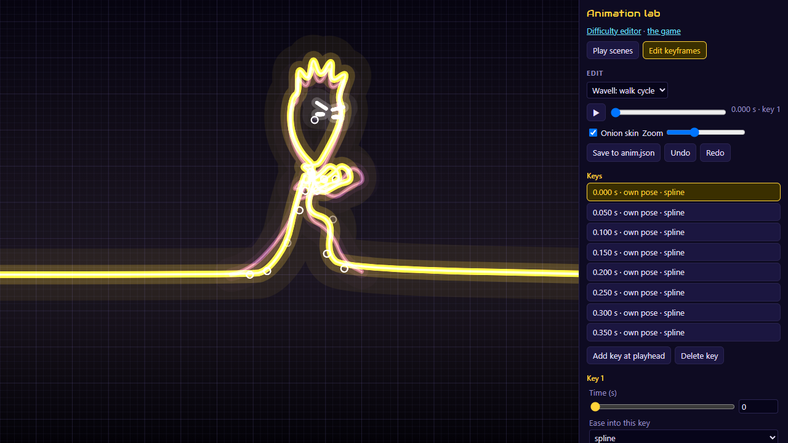

# The Line

Your world is a line. You are a wave on it, and the end of the line is coming.

*The Line* is a browser game drawn entirely in glowing vector strokes, at the screen's native resolution, with keyboard and touch controls. Nothing is a sprite: the hero, the enemies and the ground are one vibrating string, simulated with the wave equation.



**Play it:** <https://matamadio.github.io/the-line/>

## Contents

- [Run it](#run-it)
- [How to play](#how-to-play)
- [The editors](#the-editors): [difficulty editor](#difficulty-editor), [animation lab](#animation-lab), [keyframe editor](#keyframe-editor)
- [Project layout](#project-layout)
- [Commands](#commands)
- [Contributing, credits and license](#contributing)

## Run it

**To just play or test**, open the link above. It always runs the latest version of `main`, and needs no install. Bugs and impressions go in [the issues](https://github.com/matamadio/the-line/issues/new/choose).

**To work on it**, you need [Node.js](https://nodejs.org) 20 or newer:

```bash
git clone https://github.com/matamadio/the-line.git
cd the-line
npm install
npm start
```

`npm start` opens the game in your browser. Edits to the code show up as soon as you save.

**To test on a phone**, run `npm run phone` and open the `Network:` address it prints, with the phone on the same Wi-Fi. Use this on networks you trust: anyone on the network can reach the dev server while it runs.

## How to play

Keep walking right. The end of the line crumbles in behind you at nearly your walking speed, so every stop costs ground. The gauge under your lives shows how much lead is left.

| Action | Keyboard | Touch |
| --- | --- | --- |
| Walk | ← → or A D | Left thumb, sideways |
| Go through the line | ↓ or S | Right thumb, swipe down |
| Float, or come back up | ↑ or W | Right thumb, swipe up |
| Wipe | Z, Shift or Space | Right thumb, tap |
| Pull | X or Ctrl | Right thumb, swipe sideways |
| Mute | M | Speaker icon |

The one rule to remember: **pull in what is close on your side, wipe what is on the other.** The wrong attack feeds a creature and it grows. Each enemy is explained the first time it appears, and [docs/DESIGN.md](docs/DESIGN.md) has the full rules.

## The editors

The game comes with two editors, each running the real game inside a page. They change the numbers the game reads, so what you see is what ships.

| | Difficulty editor | Animation lab |
| --- | --- | --- |
| **Open with** | `npm run difficulty` | `npm run lab` |
| **Page** | `/difficulty.html` | `/lab.html` |
| **For** | How hard the game is, level by level | How things move and feel |
| **Edits** | [`src/data/difficulty.json`](src/data/difficulty.json) | [`src/data/anim.json`](src/data/anim.json) and the numbers in [`src/data/tune.ts`](src/data/tune.ts) |

When you run them from `npm run ...`, Save writes the file in your checkout, so the change appears in `git diff` like any other and goes into a pull request. A running game picks it up without reloading.

Both editors also work on the [hosted version](https://matamadio.github.io/the-line/difficulty.html), where there is no dev server to write to. There, Save copies the JSON to your clipboard instead: paste it into an issue, and a developer can put it in the file.

### Difficulty editor



The game runs on the left and every difficulty number sits on the right. Play while you change them. Most changes apply at once, and speeds and growth times apply from the next enemy.

**Reading the panel.** Anything that gets harder with level is a *ramp* of three numbers: its value at level 1, what each level adds, and a limit. Under each ramp a curve shows it from level 1 to 15, with a dot on the level being played.

| Group | What it controls |
| --- | --- |
| End of the line | Crumble speed, the most lead Wavell can build up, the pause after a respawn |
| Snawave, Worm, Bubble Burst | Speed, how often they come, when they first appear. Also: the Snawave's clock rate while Wavell stands, the Worm's while he is under the line, the Bubble's time to burst and its side |
| Backwave, Reflux | Chance per roll, how often it rolls, when it first appears |
| Fighting | Pull reach, knockback, the most sizes a creature can grow |
| Sparkles | How many at once, how many are gold, the chain window |
| Progress | Lives, points per level, extra lives, the starting level |

**The bar under the game** has restart, pause, level up and down, speeds from 0.5× to 4×, and *Endless lives*, so you can test level 10 without being good at level 9.

**The buttons:**

- **Save to game** writes `difficulty.json`.
- **Copy JSON** copies the numbers to the clipboard.
- **Revert to saved** goes back to what the file says.
- **Original values** goes back to the defaults in `src/data/difficulty.ts`, which follow the original game. Nothing is saved until you press Save.

Rows that differ from the saved file turn orange, and double-clicking a row puts it back. Unsaved edits stay in your browser between sessions.

### Animation lab



The lab plays every animation of the game on its own, slowly enough to see. Pick a scene on the right: walking, both attacks, flipping, floating, each enemy's death and bite, cancelling, dizziness, the Backwave and the burn.

**Playback**

| Control | Key |
| --- | --- |
| Play or pause | Space |
| One frame back or forward | `,` `.` |
| 12 frames back or forward | Shift + `,` `.` |
| Restart the scene | R |

The bar also has a timeline to scrub, speeds from 0.05× to 1×, zoom and a loop switch.

**Free play**, the last scene, gives you the controls and records your keys, so you can scrub back over what you just did. Playing from the middle overwrites the rest of the recording.

**Numbers.** Below the scenes, every number in `src/data/tune.ts` is a slider: walk speed, flip time, wave height, burn time, melt time and so on. A change replays the scene to the same moment, so you see its effect straight away. This works because the simulation runs on a seeded random, which makes every replay exact.

> **These sliders are not written to a file.** They stay in your browser. When you like a result, press **Copy changed values** and put those numbers in as the defaults in `src/data/tune.ts`. Double-click a row to reset it, or use **Reset all**.

### Keyframe editor



**Edit keyframes**, at the top of the lab, switches to the keyframe editor. Choose what to edit from the list:

- **Wavell:** walk cycle, wipe, pull, idle pose
- **Snawave:** outline, rise, bite, sink
- **Worm:** rise, bite, sink

The real stroke is drawn over a grid, with the keys either side shown faintly (onion skin).

**Wavell's clips** are poses over time:

- Drag a joint to change the current key. Dragging between keys adds a new one.
- Each key has a time, an ease (smooth, linear, in, out, spline, hold) and a pose.
- A pose is either one of the shared poses (idle, reach, lift, haul), which changes every key that uses it, or the key's own.
- Clips have named marks the game listens for: `grab` and `release` (when the hands hold and let go of the line), `haul`, and the walk's footfalls.
- In the walk, the knees follow the hips and feet automatically.

**The enemies' motions** are keyed numbers rather than poses: height or depth (`g`), lean and mouth for the Snawave, depth and head lunge for the Worm.

- Drag the handle on the crest (height and lean), or on the Worm's belly (depth) and head (lunge), or use the sliders.
- Each number can have its own ease, and the Snawave's last bite key can make the mouth chatter.
- In the bite motions, Wavell is drawn where the jaws close, and the `hit` mark is when they close on him.
- The melt after a kill is not keyed. Tune it with the lab's number sliders.

**Keys:** Ctrl+S saves to `anim.json`, Ctrl+Z and Ctrl+Y undo and redo.

## Project layout

```text
index.html, lab.html, difficulty.html    The three pages
src/
  main.ts          Starts the game
  core/            Knows nothing about the game: canvas renderer, input, audio
  game/
    game.ts        The rules: the simulation, spawning, attacks, scoring
    render.ts      Draws the world
    hud.ts         Draws the score, menus and touch controls
    line.ts        The line itself: a wave-equation string
    fx.ts          Sparks, debris, score popups
    actors/        Wavell, Snawave, Worm, Bubble Burst
  data/            The tunable numbers and the files the editors save
  editors/         The difficulty editor and the animation lab
test/              Headless tests: the real simulation, no browser
tools/             The dev server's save endpoint for the editors
public/assets/     Sounds and music
docs/              Game design notes and the original game's event list
```

## Commands

| Command | What it does |
| --- | --- |
| `npm start` | Runs the game and opens it in your browser |
| `npm run dev` | The same, without opening a browser |
| `npm run difficulty` | Opens the difficulty editor |
| `npm run lab` | Opens the animation lab |
| `npm run phone` | Runs the game so phones on your network can reach it |
| `npm run check` | Type-checks and runs the tests: what CI runs on each pull request |
| `npm run build` | Type-checks and builds the static site into `dist/` |
| `npm run preview` | Serves `dist/` to try out the build |

`dist/` can be hosted anywhere, under any path. It needs a web server, because browsers refuse to load it from a `file://` address.

## Contributing

See [CONTRIBUTING.md](CONTRIBUTING.md). In short: branch, change, `npm run check`, open a pull request. You don't need to write code to help: playing and reporting, or tuning the difficulty and sending in the numbers, are both useful.

## Credits

*The Line* grows out of *The Line continues* (Bepposoft, 2003), a game by Beppo made with The Games Factory and Multimedia Fusion, with a little help by Lupo, technical contributions by Cappy, and the online hiscore page by Mk. The sound effects and the music come from that game, and timings and speeds follow its events wherever there is one to follow ([docs/original-events.txt](docs/original-events.txt)).

## License

No license has been chosen yet, so all rights are reserved for now. Sounds and music remain the property of their respective authors.
